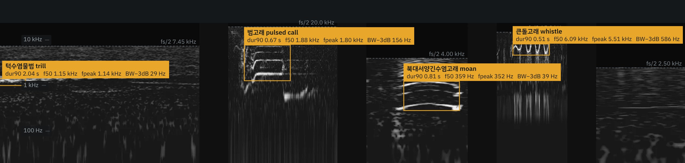
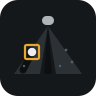
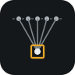

<!-- README.md는 README.template.md에서 매일 자동으로 만들어집니다. 내용은 README.template.md를 고치세요 (나이 · 경력은 자동 계산). -->

<h1 align="center">이종찬 Jongchan Lee</h1>

  <b>Underwater Acoustic Engineer</b> (수중음향 시스템 엔지니어) &nbsp;|&nbsp; 만 {{AGE}}세 
  ㈜지오시스템리서치 시스템개발부 전임연구원 (2022.05 – 현재) 
  <b>수중음향 기반 엔지니어링 실무 경험 {{CAREER}}</b>

  
  
  
  
  

바다 속 소리로 해양생물과 해양환경을 이해하는 도구를 만듭니다. 
하이드로폰 · 소나 계측부터 신호처리, AI 기반 탐지 · 분류, 시스템 통합과 현장 운용까지 다뤄 왔습니다.

### Core Competencies (핵심 역량)

| 분야 | 핵심 기술 |
|---|---|
| **Active Sonar Signal Processing** (능동 소나 신호처리) | CW · LFM(선형주파수변조) 펄스, M-sequence 기반 진폭변조 신호처리, Matched Filtering(정합 필터링) · 펄스 압축, 분할빔 위상차 각도 추정, TS · Sv 후방산란 산출, 해저면 · 생물 신호 분리 |
| **Sonar Imaging** (소나 영상) | Backprojection(역투영) 영상 형성, Motion Compensation(이동 보상), Autofocus(PGA · 엔트로피 최소화 · 딥러닝), 측면주사 소나 표적 탐지 |
| **Passive Acoustic Monitoring** (수동음향 모니터링) | 하이드로폰 계류 · 녹음 설계, 발성 · 클릭 탐지 · 분류 · 위치추정(DCL), 신호 특징 측정(지속시간 · 중심 · 첨두 주파수 · 대역폭), 1/3 옥타브 Leq 배경소음 분석 |
| **Array Signal Processing** (배열 신호처리) | 희소 배열 설계, 공간 앨리어싱 분석, MVDR 적응 빔포밍, GCC-PHAT TDOA 방위 추정 |
| **Propagation Modeling** (음파 전달 모델링) | PE(포물선 방정식) · Bellhop(음선) 전달손실 계산, 소나 방정식 기반 탐지성능 분포도, 계절별 음속 구조 반영 센서 배치 |
| **AI Detection & Classification** (AI 탐지 · 분류) | CNN · Transformer 오디오 표현(AST · VGGish · EfficientNet), YOLOv8 · RT-DETR 탐지, 크기 맞춤 증강, 녹음 출처 분리 평가 · FROC · Pd@FA 평가, Whisper STT |
| **System Integration & Test** (시스템 통합 · 시험) | 센서 · 처리 모듈 통합, 실시간 처리 파이프라인, 임베디드 수집(Raspberry Pi · DAQ), 수조 · 실해역 성능 시험, 운용 매뉴얼 · SOP |

| Tech Stack | |
|---|---|
| Languages | Python · Julia · MATLAB · Java · Cython |
| Signal Processing · AI | NumPy · SciPy · Numba · PyTorch · Ultralytics · scikit-learn |
| Acoustic Modeling | PE · Bellhop |
| Hardware | Kongsberg EK80 · BioSonics DT-X · Raspberry Pi 5 + MCC 172 · GRAS 40PH · 하이드로폰 계류 |

### Open research (공개 연구)

<table>
  <tr>
    <td align="center" width="33%" valign="top">
       
      <b>Marine mammal classifier</b> 
      녹음 출처 분리 평가에서 종 분류 BA 0.64–0.76 → 0.21–0.33
    </td>
    <td align="center" width="33%" valign="top">
       
      <b>Side-scan sonar MLO</b> 
      미학습 연도 기뢰유사물체 탐지, 크기 맞춤 증강 Pd +13%p
    </td>
    <td align="center" width="33%" valign="top">
       
      <b>SAS signal processing</b> 
      원시 신호 영상 형성 · 항법 오차 민감도 · 딥러닝 보정
    </td>
  </tr>
</table>

배너: Watkins Marine Mammal Sound Database(WHOI) 실제 녹음으로 만든 스펙트로그램. 측정 방법은 웹사이트의 "자료와 측정 방법" 참고.
